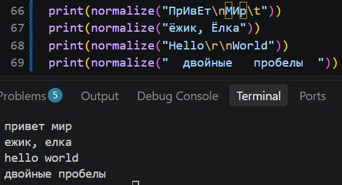
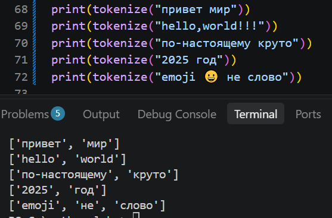
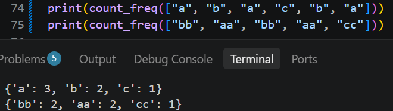
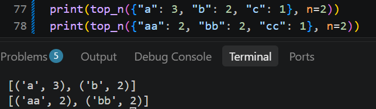
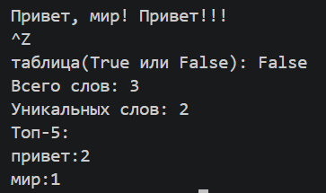
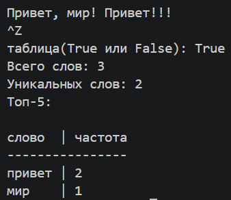

# ЛР3 — Тексты и частоты слов (словарь/множество)
## Задание A
1. 

```
def normalize(text: str, *, casefold: bool = True, yo2e: bool = True) -> str:
    '''приводит строку к casefold, заменяет ё на е,заменяет управляющие символы \t, \r, \n на пробел, \
        меняет несколько пробелов на один, убирает пробелы по бокам'''
    if casefold:
        text = text.casefold()
    else:
        text = text.lower()

    if yo2e:
        text = text.replace('ё', 'е').replace('Ё', 'Е')

    control_chars = {chr(i) for i in range(32)} | {'\u007f'}

    chars = []
    for ch in text:
        if ch in control_chars:
            chars.append(" ")
        else:
            chars.append(ch)

    text = "".join(chars)
    text = " ".join(text.split())

    return text
```    



2. 
```
import re


def tokenize(text: str) -> list[str]:
    '''разбивает строку на «слова» по небуквенно-цифровым разделителям'''
    pattern = r'\w+(?:-\w+)*'
    return [match.group() for match in re.finditer(pattern, text)]
```



3. 
```
def count_freq(tokens: list[str]) -> dict[str, int]:
    '''считает частоты, возвращает словарь слово → количество'''
    freq = {}
    for token in tokens:
        freq[token] = freq.get(token, 0) + 1
    return freq
```



4. 
```
def top_n(freq: dict[str, int], n: int = 5) -> list[tuple[str, int]]:
    '''возвращает топ-N по убыванию частоты; при равенстве — по алфавиту слова'''
    if not isinstance(freq, dict):
        raise ValueError("Первый аргумент должен быть словарём.")

    if not all(isinstance(v, int) for v in freq.values()):
        raise ValueError("Значения в словаре должны быть целыми числами.")

    sorted_items = sorted(freq.items(), key=lambda x: (-x[1], x[0]))
    return sorted_items[:n]
```




## Задание B

Скрипт читает ввод до EOF и True или False для таблицы, вызывает функции из lib/text.py и печатает:

Всего слов: <N>
Уникальных слов: <K>
Топ-5: — по строке на запись в формате слово:кол-во (по убыванию, как в top_n)(или в виде таблицы).

```
import sys
import os

base_dir = os.path.dirname(os.path.dirname(os.path.abspath(__file__)))
sys.path.append(os.path.join(base_dir, "lib"))

from text import *

s = sys.stdin.read()

tablitsa = input("таблица(True или False): ").strip().lower()

s_norm = normalize(s)
s_token = tokenize(s_norm)
freq = count_freq(s_token)
top5 = top_n(freq, 5)

print(f'Всего слов: {len(s_token)}')
print(f'Уникальных слов: {len(freq)}')
print('Топ-5:')

if tablitsa == 'false':
    for token in top5:
        print(f'{token[0]}:{token[1]}')

elif tablitsa == 'true':
    max_len = max((len(w) for w, _ in top5), default=5)
    header_word = 'слово'.ljust(max_len)

    print()
    print(f'{header_word} | частота')
    print('-' * (max_len + 10))
    for word, count in top5:
        print(f'{word.ljust(max_len)} | {count}')

```



