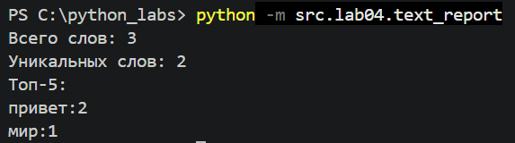
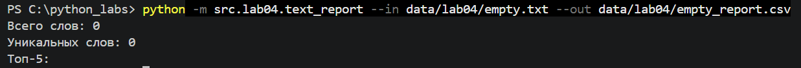
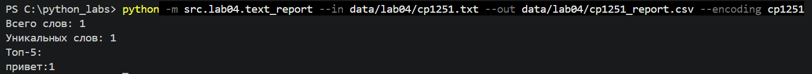

# ЛР4 — Файлы: TXT/CSV и отчёты по текстовой статистике
## Задание A
1. read_text
Функция read_text читает текст из файла в указанной кодировке и возвращает его в виде строки. Если файл не найден или кодировка указана неверно, возникает ошибка. Функция write_csv записывает данные в CSV-файл в табличном виде. Она принимает данные и путь к файлу, а также может добавлять заголовки столбцов





## Задание B
Скрипт читает входной текстовый файл, путь к которому, путь к выходному CSV-файлу и кодировка задаются по умолчанию: data/lab04/input.txt, data/lab04/report.csv и utf-8. При запуске эти параметры можно изменить с помощью аргументов --in, --out и --encoding. Текст нормализуется и разбивается на слова с помощью функций из src/lib/text.py, после чего подсчитываются частоты слов. Полный отчёт сохраняется в CSV-файл с колонками word,count, отсортированными по убыванию частоты и по алфавиту при равенстве частот. В консоль выводятся общее количество слов, количество уникальных слов и топ-5 самых частых слов. Если входной файл не найден или возникает ошибка чтения кодировки, скрипт выводит сообщение об ошибке и завершает работу

Политика обработки краевых ситуаций и ошибок
- Файл не найден: выводится сообщение об ошибке, программа завершается с кодом 1
- Пустой файл: выводится 0 слов и 0 уникальных слов, CSV содержит только заголовок word,count
- Ошибка кодировки: выводится сообщение об ошибке чтения, кодировка задаётся параметром --encoding(например, cp1251)
- Не указаны пути: используются пути по умолчанию
- Выходная папка отсутствует: создаётся автоматически
- Ошибка записи: программа сообщает об ошибке

## Способ запуска `text_report.py`

Запуск выполняется из корня репозитория (там, где лежит папка `src/`), с помощью флага `-m`:

```python
python -m src.lab04.text_report
```

---

## Тест-кейс А: Базовый одиночный файл
Входной файл (`data/lab04/input.txt`):
```
Привет, мир! Привет!!!
```
Вывод в консоль терминала:
```
Всего слов: 3
Уникальных слов: 2
Топ-5:
привет: 2
мир: 1
```
Содержимое созданного отчёта (`data/lab04/report.csv`):
```
word,count
привет,2
мир,1
```

## Тест-кейс B: Пустой файл
Входной файл (`data/lab04/empty.txt`)

Вывод в консоль терминала:
```
Всего слов: 0
Уникальных слов: 0
Топ-5:
```
Содержимое созданного отчёта:
```
word,count
```

## Тест-кейс C: Кодировка cp1251
Входной файл (`data/lab04/cp1251.txt`):
```
������
```
Вывод в консоль терминала:
```
Всего слов: 1
Уникальных слов: 1
Топ-5:
привет:1
```
Содержимое созданного отчёта:
```
word,count
привет,1
```