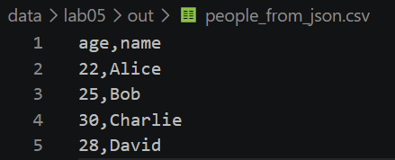
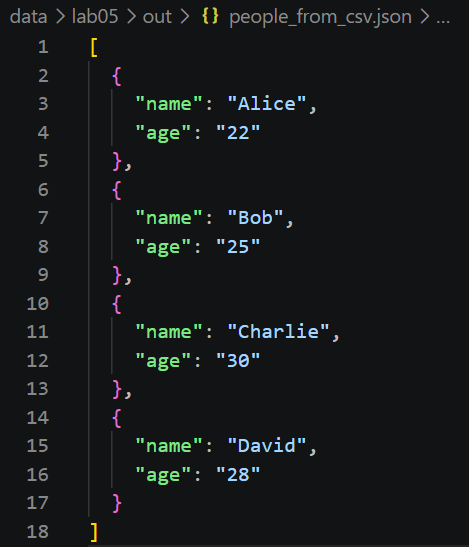
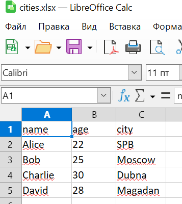
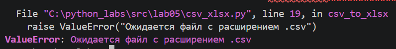

# ЛР5 — JSON и конвертации (JSON↔CSV, CSV→XLSX)

## Задание A — JSON ↔ CSV

## json_to_csv()

```
import csv
import json
from pathlib import Path


def json_to_csv(json_path: str, csv_path: str) -> None:
    """
    Преобразует JSON-файл в CSV.
    Поддерживает список словарей [{...}, {...}], заполняет отсутствующие поля пустыми строками.
    Кодировка UTF-8. Порядок колонок — как в первом объекте или алфавитный (указать в README).
    """
    source = Path(json_path)
    destination = Path(csv_path)

    if source.suffix.lower() != ".json":
        raise ValueError("Ожидается файл с расширением .json")

    if destination.suffix.lower() != ".csv":
        raise ValueError("Ожидается файл с расширением .csv")

    with source.open("r", encoding="utf-8") as file:
        data = json.load(file)

    if not isinstance(data, list) or not data:
        raise ValueError("JSON должен содержать непустой список словарей")

    if not all(isinstance(item, dict) for item in data):
        raise ValueError("Все элементы JSON должны быть словарями")

    fieldnames = sorted({key for item in data for key in item})

    if not fieldnames:
        raise ValueError("В JSON отсутствуют поля для записи в CSV")

    with destination.open("w", encoding="utf-8", newline="") as file:
        writer = csv.DictWriter(file, fieldnames=fieldnames, restval="")
        writer.writeheader()
        writer.writerows(data)
```

преобразовывает данные из json-файла в csv-файл. сначала проверяется, что входной файл имеет расширение json, а выходной — csv. затем данные считываются из json-файла и проверяется, что они представлены в виде непустого списка словарей. на основе ключей словарей формируется список заголовков столбцов в алфавитном порядке. после этого создаётся csv-файл, в который записываются заголовки и данные. если в каком-либо словаре отсутствует ключ, соответствующая ячейка остаётся пустой.


## csv_to_json()

```
def csv_to_json(csv_path: str, json_path: str) -> None:
    """
    Преобразует CSV в JSON (список словарей).
    Заголовок обязателен, значения сохраняются как строки.
    json.dump(..., ensure_ascii=False, indent=2)
    """
    source = Path(csv_path)
    destination = Path(json_path)

    if source.suffix.lower() != ".csv":
        raise ValueError("Ожидается файл с расширением .csv")

    if destination.suffix.lower() != ".json":
        raise ValueError("Ожидается файл с расширением .json")

    with source.open("r", encoding="utf-8", newline="") as file:
        reader = csv.DictReader(file)

        if not reader.fieldnames or not any(name is not None and name.strip() for name in reader.fieldnames):
            raise ValueError("В CSV отсутствует заголовок")

        if any(name is None or not name.strip() for name in reader.fieldnames):
            raise ValueError("Заголовки CSV не должны быть пустыми")

        data = list(reader)

    if not data:
        raise ValueError("CSV не содержит строк с данными")

    with destination.open("w", encoding="utf-8", newline="") as file:
        json.dump(data, file, ensure_ascii=False, indent=2)
```

преобразует данные из csv-файла в json-файл. сначала проверяется, что входной файл имеет расширение csv, а выходной — json. затем данные считываются из csv-файла с помощью csv.dictreader, который использует первую строку как заголовки столбцов и формирует для каждой последующей строки словарь. проверяется наличие заголовков и строк с данными. после этого список словарей записывается в json-файл в формате utf-8 с сохранением русских символов и отступами для удобства чтения.


## Задание B — CSV → XLSX

## csv_to_xlsx()

```
import csv
from pathlib import Path
from openpyxl import Workbook


def csv_to_xlsx(csv_path: str, xlsx_path: str) -> None:
    """
    Преобразует CSV-файл в XLSX.
    Первая строка CSV содержит заголовки.
    Лист называется Sheet1.
    Ширина столбцов подбирается по длине текста,
    но составляет не менее 8 символов.
    Кодировка исходного файла — UTF-8.
    """
    source = Path(csv_path)
    destination = Path(xlsx_path)

    if source.suffix.lower() != ".csv":
        raise ValueError("Ожидается файл с расширением .csv")

    if destination.suffix.lower() != ".xlsx":
        raise ValueError("Ожидается файл с расширением .xlsx")

    with source.open("r", encoding="utf-8", newline="") as file:
        reader = csv.reader(file)
        rows = list(reader)

    if not rows or not any(cell.strip() for row in rows for cell in row):
        raise ValueError("CSV-файл пуст")

    header = rows[0]

    if not header or any(not cell.strip() for cell in header):
        raise ValueError("CSV должен содержать непустые заголовки")

    if any(len(row) != len(header) for row in rows):
        raise ValueError(
            "Количество столбцов в строках не совпадает с заголовком")

    workbook = Workbook()
    sheet = workbook.active
    sheet.title = "Sheet1"

    for row in rows:
        sheet.append(row)

    for column in sheet.columns:
        max_length = max(len(str(cell.value or "")) for cell in column)
        column_letter = column[0].column_letter
        sheet.column_dimensions[column_letter].width = max(8, max_length + 2)

    workbook.save(destination)
    workbook.close()

```

преобразует данные из csv-файла в файл excel с расширением xlsx. сначала проверяется правильность расширений входного и выходного файлов. затем данные считываются из csv-файла с помощью csv.reader. проверяется, что файл не пустой, заголовки заполнены, а количество значений в каждой строке совпадает с количеством заголовков. после проверки создаётся книга excel, в которую добавляются заголовки и данные. ширина столбцов автоматически подбирается по длине самого длинного значения с небольшим запасом. в конце книга сохраняется в указанный xlsx-файл.


## Вывод результата - файлы 

### json_to_csv()
входные данные - файл people.json:
```
[
  {"name": "Alice", "age": 22},
  {"name": "Bob", "age": 25},
  {"name": "Charlie", "age": 30},
  {"name": "David", "age": 28}
]
```
результат - файл people_from_json.scv
```
age,name
22,Alice
25,Bob
30,Charlie
28,David
```

### csv_to_json
входные данные - файл people.csv:
```
age,name
22,Alice
25,Bob
30,Charlie
28,David
```
результат - файл people_from_scv.json
```
[
  {
    "name": "Alice",
    "age": "22"
  },
  {
    "name": "Bob",
    "age": "25"
  },
  {
    "name": "Charlie",
    "age": "30"
  },
  {
    "name": "David",
    "age": "28"
  }
]
```

### csv_xlsx()
входные данные - файл cities.csv:
```
name,age,city
Alice,22,SPB
Bob,25,Moscow
Charlie,30,Dubna
David,28,Magadan
```
результат - people.xlsx





## Обработка ошибок расширений входных файлов

В функциях конвертации предусмотрена проверка расширений файлов. Если входной файл имеет неподдерживаемое расширение, функция вызывает `ValueError` с сообщением об ожидаемом формате.

- `json_to_csv()` ожидает входной файл `.json`;
- `csv_to_json()` ожидает входной файл `.csv`;
- `csv_to_xlsx()` ожидает входной файл `.csv`.

Также проверяется расширение выходного файла: `.csv`, `.json` или `.xlsx` в зависимости от функции.



## Запуск с помощью скрипта out.py из корня проекта через python3 -m src.lab05.out

```python
from src.lab05.json_csv import json_to_csv, csv_to_json
from src.lab05.csv_xlsx import csv_to_xlsx

json_to_csv("data/lab05/samples/people.json", "data/lab05/out/people_from_json.csv")
csv_to_json("data/lab05/samples/people.csv", "data/lab05/out/people_from_csv.json")
csv_to_xlsx("data/lab05/samples/people.csv", "data/lab05/out/people.xlsx")
```