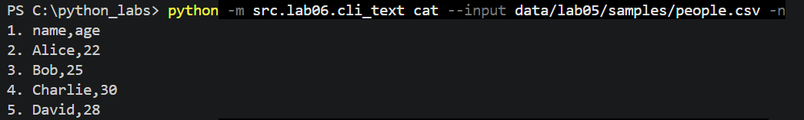
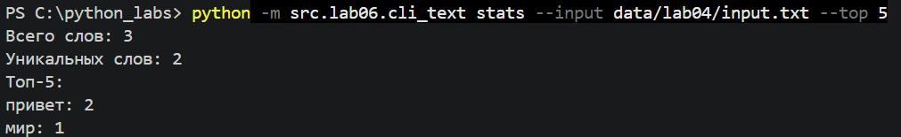
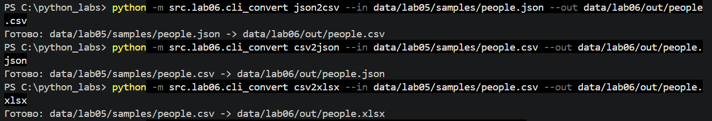
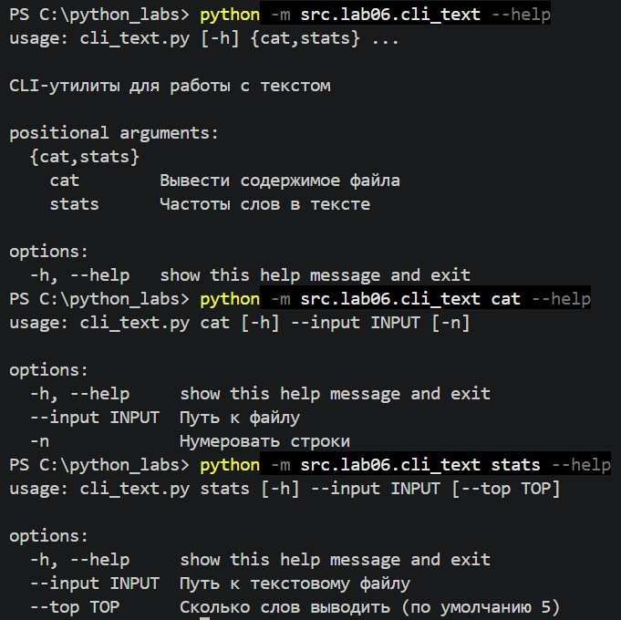
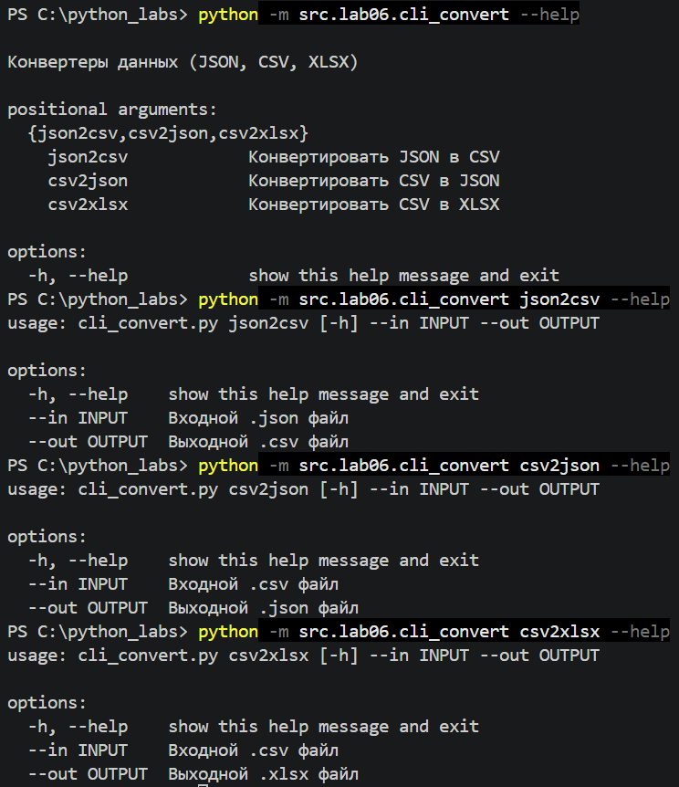
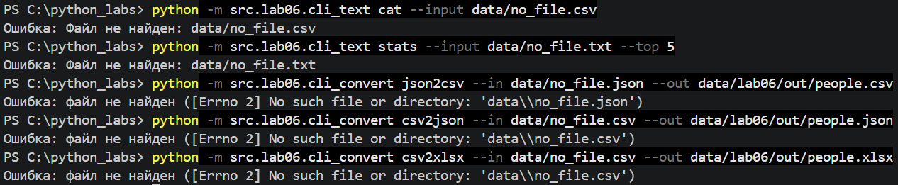
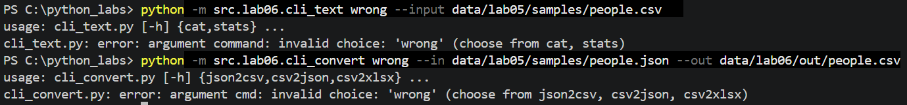
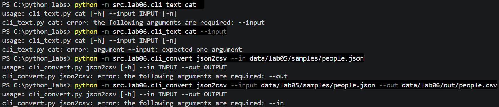
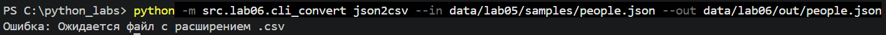

# ЛР6 - CLI-утилиты с argparse (cat/grep-lite + конвертеры)

## cli_text.py

```
import argparse
from pathlib import Path
from src.lib.text import normalize, tokenize, count_freq, top_n
from src.lab04.io_txt_csv import read_text


def check_file(path: str) -> None:
    """проверяет, что входной файл существует"""
    if not Path(path).is_file():
        raise FileNotFoundError(f"Файл не найден: {path}")


def cmd_cat(path: str, numbered: bool) -> None:
    """выводит файл построчно, при numbered=True - с номерами"""
    check_file(path)
    text = read_text(path)
    number = 1
    for line in text.splitlines():
        if numbered:
            print(f"{number}. {line}")
        else:
            print(line)
        number += 1


def cmd_stats(path: str, top: int) -> None:
    """выводит топ-N самых частых слов файла"""
    check_file(path)
    text = read_text(path)
    tokens = tokenize(normalize(text))
    freq = count_freq(tokens)

    print(f"Всего слов: {len(tokens)}")
    print(f"Уникальных слов: {len(freq)}")
    print(f"Топ-{top}:")
    for word, count in top_n(freq, top):
        print(f"{word}: {count}")


def main() -> None:
    parser = argparse.ArgumentParser(
        description="CLI-утилиты для работы с текстом")
    subparsers = parser.add_subparsers(dest="command")

    cat_parser = subparsers.add_parser("cat", help="Вывести содержимое файла")
    cat_parser.add_argument("--input", required=True, help="Путь к файлу")
    cat_parser.add_argument("-n", action="store_true",
                            help="Нумеровать строки")

    stats_parser = subparsers.add_parser("stats", help="Частоты слов в тексте")
    stats_parser.add_argument("--input", required=True,
                              help="Путь к текстовому файлу")
    stats_parser.add_argument(
        "--top", type=int, default=5, help="Сколько слов выводить (по умолчанию 5)")

    args = parser.parse_args()

    if args.command is None:
        parser.error("нужно указать подкоманду: cat или stats")

    try:
        if args.command == "cat":
            cmd_cat(args.input, args.n)
        elif args.command == "stats":
            if args.top <= 0:
                parser.error("--top должно быть положительным числом")
            cmd_stats(args.input, args.top)
    except FileNotFoundError as e:
        print(f"Ошибка: {e}")


if __name__ == "__main__":
    main()
```
- check_file() проверяет, существует ли указанный пользователем файл. Если файл не найден, вызывает ошибку FileNotFoundError.
- cmd_cat() читает содержимое файла и выводит его в терминал построчно. При использовании флага -n добавляет номера строк.
- cmd_stats() анализирует текстовый файл: нормализует текст, разбивает его на слова, подсчитывает частоту каждого слова и выводит общее количество слов, количество уникальных слов и топ самых частых слов.
- main() создаёт интерфейс командной строки с помощью библиотеки argparse и настраивает подкоманды.
- Обработка аргументов: программа получает от пользователя путь к файлу, флаг нумерации строк и количество слов для вывода в топе.
- Проверка параметров: проверяется наличие подкоманды и положительное значение параметра --top.
- Обработка ошибок: если файл не найден, программа выводит соответствующее сообщение.


## cli_convert.py

```
import argparse
from src.lab05.json_csv import json_to_csv, csv_to_json
from src.lab05.csv_xlsx import csv_to_xlsx


def main() -> None:
    parser = argparse.ArgumentParser(
        description="Конвертеры данных (JSON, CSV, XLSX)")
    sub = parser.add_subparsers(dest="cmd")

    p1 = sub.add_parser("json2csv", help="Конвертировать JSON в CSV")
    p1.add_argument("--in", dest="input", required=True,
                    help="Входной .json файл")
    p1.add_argument("--out", dest="output", required=True,
                    help="Выходной .csv файл")

    p2 = sub.add_parser("csv2json", help="Конвертировать CSV в JSON")
    p2.add_argument("--in", dest="input", required=True,
                    help="Входной .csv файл")
    p2.add_argument("--out", dest="output", required=True,
                    help="Выходной .json файл")

    p3 = sub.add_parser("csv2xlsx", help="Конвертировать CSV в XLSX")
    p3.add_argument("--in", dest="input", required=True,
                    help="Входной .csv файл")
    p3.add_argument("--out", dest="output", required=True,
                    help="Выходной .xlsx файл")

    args = parser.parse_args()

    if args.cmd is None:
        parser.error(
            "нужно указать подкоманду: json2csv, csv2json или csv2xlsx")

    try:
        if args.cmd == "json2csv":
            json_to_csv(args.input, args.output)
        elif args.cmd == "csv2json":
            csv_to_json(args.input, args.output)
        elif args.cmd == "csv2xlsx":
            csv_to_xlsx(args.input, args.output)
        print(f"Готово: {args.input} -> {args.output}")
    except FileNotFoundError as e:
        print(f"Ошибка: файл не найден ({e})")
    except ValueError as e:
        print(f"Ошибка: {e}")


if __name__ == "__main__":
    main()
```
- Импорт готовых функций из ЛР5(json_to_csv,csv_to_json,csv_to_xlsx).
- Подкоманды: через add_subparsers(dest="cmd") создаются json2csv, csv2json и csv2xlsx, для каждой команды задаются два обязательных параметра --in и --out. Так как in является ключевым словом python, значения сохраняются в args.input и args.output через параметр dest.
- Вызов функции: в зависимости от args.cmd вызывается нужная функция из ЛР5.
- Обработка ошибок: FileNotFoundError если входной файл не найден, ValueError введены некорректрые данные.


## Запуск программы

### cat

people.csv
```
name,age
Alice,22
Bob,25
Charlie,30
David,28
```



### stats

input.txt
```
Привет, мир! Привет!!!
```



### cli_convert.py


### out

people.csv
```
age,name
22,Alice
25,Bob
30,Charlie
28,David
```

people.json
```
[
  {
    "name": "Alice",
    "age": "22"
  },
  {
    "name": "Bob",
    "age": "25"
  },
  {
    "name": "Charlie",
    "age": "30"
  },
  {
    "name": "David",
    "age": "28"
  }
]
```

people.xlsx


## Вывод справки --help

cli_text.py



cli_convert.py



## Обработка ошибок

Несуществующий файл:


Несуществующая подкоманда:


Неверные аргументы:


Неверное расширение:
