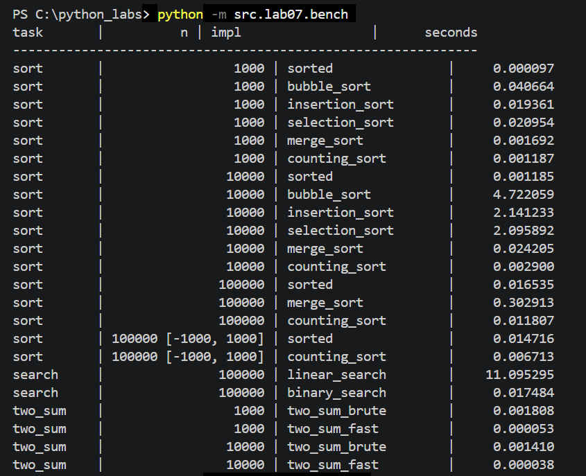
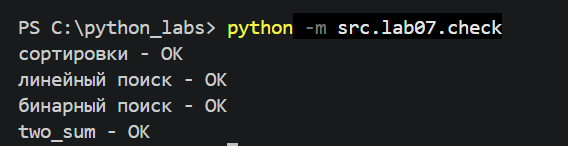

# ЛР7 — Поиск, сортировка и измерение времени
## 1. search.py
```
def linear_search(nums, x):
    """Индекс первого вхождения x или -1.

    linear_search([4, 2, 7, 2], 2) -> 1
    linear_search([4, 2, 7, 2], 9) -> -1
    linear_search([], 1) -> -1
    """
    for i in range(len(nums)):
        if nums[i] == x:
            return i
    return -1


def binary_search(sorted_nums, x):
    """Индекс x в отсортированном по возрастанию списке или -1.
    На неотсортированном списке результат не определён.

    binary_search([1, 3, 5, 7], 5) -> 2
    binary_search([1, 3, 5, 7], 4) -> -1
    binary_search([5], 5) -> 0
    binary_search([], 5) -> -1
    """
    lo = 0
    hi = len(sorted_nums) - 1

    while lo <= hi:
        mid = (lo + hi) // 2
        if sorted_nums[mid] == x:
            return mid
        elif x > sorted_nums[mid]:
            lo = mid + 1
        else:
            hi = mid - 1
    return -1


def two_sum_brute(nums, target):
    """Пара индексов (i, j), i < j, nums[i] + nums[j] == target, или None.

    two_sum_brute([2, 7, 11, 15], 9) -> (0, 1)
    two_sum_brute([1, 2], 10) -> None
    """
    for i in range(len(nums) - 1):
        for j in range(i + 1, len(nums)):
            if nums[i] + nums[j] == target:
                return (i, j)
    return None


def two_sum_fast(nums, target):
    """Пара индексов (i, j), i < j, nums[i] + nums[j] == target, или None.
    То же, что two_sum_brute, но за один проход со словарём.

    two_sum_fast([2, 7, 11, 15], 9) -> (0, 1)
    two_sum_fast([1, 2], 10) -> None
    """
    seen = {}
    for i, num in enumerate(nums):
        num2 = target - num
        if num2 in seen:
            return (seen[num2], i)
        seen[num] = i
    return None
```

## 2. sorting.py
```
def bubble_sort(nums):
    """Новый список, отсортированный по возрастанию. Исходный не меняется.

    bubble_sort([3, 1, 2]) -> [1, 2, 3]
    bubble_sort([2, 2, 1]) -> [1, 2, 2]
    bubble_sort([]) -> []
    """
    nums_copy = list(nums)
    n = len(nums_copy)

    for i in range(n - 1):
        swapped = False
        for j in range(n - 1 - i):
            if nums_copy[j] > nums_copy[j + 1]:
                nums_copy[j], nums_copy[j + 1] = nums_copy[j + 1], nums_copy[j]
                swapped = True
        if not swapped:
            break
    return nums_copy


def insertion_sort(nums):
    """Новый список, отсортированный по возрастанию. Исходный не меняется."""

    nums_copy = list(nums)
    n = len(nums_copy)

    for i in range(1, n):
        num = nums_copy[i]
        j = i - 1
        while j >= 0 and nums_copy[j] > num:
            nums_copy[j + 1] = nums_copy[j]
            j -= 1
        nums_copy[j + 1] = num

    return nums_copy


def selection_sort(nums):
    """Новый список, отсортированный по возрастанию. Исходный не меняется."""

    nums_copy = list(nums)
    n = len(nums_copy)

    for i in range(n):
        mn_index = i
        for j in range(i, n):
            if nums_copy[j] < nums_copy[mn_index]:
                mn_index = j
        if i != mn_index:
            nums_copy[i], nums_copy[mn_index] = nums_copy[mn_index], nums_copy[i]
    return nums_copy


def merge_sort(nums):
    """
    сортировка слиянием без рекурсии

    возвращает список, отсортированный по возрастанию. Исходный не меняется.

    merge_sort([3, 1, 2]) -> [1, 2, 3]
    merge_sort([1]) -> [1]
    merge_sort([]) -> []
    """

    n = len(nums)
    if n <= 1:
        return list(nums)

    nums_copy = list(nums)
    temp = [0] * n

    ln = 1
    while ln < n:
        i = 0
        while i < n:
            left = i
            mid = min(i + ln, n)
            right = min(i + 2 * ln, n)

            l, r, k = left, mid, left

            while l < mid and r < right:
                if nums_copy[l] <= nums_copy[r]:
                    temp[k] = nums_copy[l]
                    l += 1
                else:
                    temp[k] = nums_copy[r]
                    r += 1
                k += 1

            while l < mid:
                temp[k] = nums_copy[l]
                l += 1
                k += 1
            while r < right:
                temp[k] = nums_copy[r]
                r += 1
                k += 1

            for idx in range(left, right):
                nums_copy[idx] = temp[idx]
            i += 2 * ln
        ln *= 2

    return nums_copy


def counting_sort(nums, lo, hi):
    """
    сортировка подсчётом для целых чисел в известном диапазоне [lo, hi]
    возвращает новый список, отсортированный по возрастанию. Исходный не меняется

    counting_sort([3, 1, 2, 3], 1, 5) -> [1, 2, 3, 3]
    counting_sort([5, 5, 5], 5, 10) -> [5, 5, 5]
    counting_sort([], 0, 10) -> []
    """

    n = len(nums)
    if n <= 1:
        return list(nums)

    range_size = hi - lo + 1
    count = [0] * range_size

    for x in nums:
        count[x - lo] += 1

    res = []
    for offset, c in enumerate(count):
        if c > 0:
            value = lo + offset
            res.extend([value] * c)

    return res
```

## 3. check.py
```
import random
from src.lab07.sorting import bubble_sort, insertion_sort, selection_sort, merge_sort, counting_sort
from src.lab07.search import linear_search, binary_search, two_sum_brute, two_sum_fast


def check_sorting(fn, trials=100):
    for _ in range(trials):
        n = random.randint(0, 50)
        nums = [random.randint(-100, 100) for _ in range(n)]
        original = list(nums)
        result = fn(nums)
        assert result == sorted(
            nums), f"{fn.__name__} ошиблась на {nums}: {result}"
        assert nums == original, f"{fn.__name__} изменила исходный список"


def check_counting_sort(trials=100):
    for _ in range(trials):
        n = random.randint(0, 50)
        nums = [random.randint(-100, 100) for _ in range(n)]

        if nums:
            lo = random.randint(min(nums) - 100, min(nums))
            hi = random.randint(max(nums), max(nums) + 100)

            original = list(nums)
            result = counting_sort(nums, lo, hi)
            assert result == sorted(
                nums), f"counting_sort ошиблась на {nums}: {result}"
            assert nums == original, f"counting_sort изменила исходный список"
        else:
            assert n == 0, "понятия не имею"


def check_linear_search(fn, trials=100):
    for _ in range(trials):
        n = random.randint(0, 50)
        target = random.randint(-150, 150)
        nums = [random.randint(-100, 100) for _ in range(n)]
        original = list(nums)
        result = fn(nums, target)
        try:
            answer = nums.index(target)
        except ValueError:
            answer = -1
        assert result == answer, f"{fn.__name__} ошиблась на {nums}: {result}, верный ответ: {answer}"
        assert nums == original, f"{fn.__name__} изменила исходный список"


def check_binary_search(fn, trials=100):
    for _ in range(trials):
        n = random.randint(0, 50)
        target = random.randint(-150, 150)
        nums = sorted([random.randint(-100, 100) for _ in range(n)])
        original = list(nums)
        result = fn(nums, target)
        try:
            answer = nums.index(target)
        except ValueError:
            answer = -1
        assert result == answer, f"{fn.__name__} ошиблась на {nums}: {result}, верный ответ: {answer}"
        assert nums == original, f"{fn.__name__} изменила исходный список"


def check_two_sum(trials=1000):
    for trial in range(trials):
        n = random.randint(0, 50)
        target = random.randint(-50, 50)
        nums = [random.randint(-100, 100) for _ in range(n)]

        res1 = two_sum_brute(nums, target)
        res2 = two_sum_fast(nums, target)

        if res1 is None and res2 is None:
            continue

        if res1 is not None and res2 is not None:
            i1, j1 = res1
            i2, j2 = res2

            assert i1 != j1, f"Индексы совпали в two_sum_brute: {res1} на nums={nums}, target={target}"
            assert all(0 <= idx < len(nums) for idx in (i1, j1)
                       ), f"Неверные индексы в two_sum_brute: {res1}"
            assert nums[i1] + \
                nums[j1] == target, f"Сумма не совпадает в two_sum_brute: {nums[i1]} + {nums[j1]} != {target}"

            assert i2 != j2, f"Индексы совпали в two_sum_fast: {res2} на nums={nums}, target={target}"
            assert all(0 <= idx < len(nums) for idx in (i2, j2)
                       ), f"Неверные индексы в two_sum_fast: {res2}"
            assert nums[i2] + \
                nums[j2] == target, f"Сумма не совпадает в two_sum_fast: {nums[i2]} + {nums[j2]} != {target}"
            continue

        raise AssertionError(
            f"Разные результаты на nums={nums}, target={target}\n"
            f"two_sum_brute={res1}, two_sum_fast={res2}"
        )


def main():
    random.seed(42)
    for fn in (bubble_sort, insertion_sort, selection_sort, merge_sort):
        check_sorting(fn)
    print("сортировки - OK")

    check_counting_sort()

    check_linear_search(linear_search)
    print("линейный поиск - OK")

    check_binary_search(binary_search)
    print("бинарный поиск - OK")

    check_two_sum()
    print("two_sum - OK")


if __name__ == "__main__":
    main()
```

## 4. bench.py
```
import csv
import timeit
import random

from src.lab07.sorting import bubble_sort, insertion_sort, selection_sort, merge_sort, counting_sort
from src.lab07.search import linear_search, binary_search, two_sum_brute, two_sum_fast


def data(n):
    """случайный список из n чисел от -1000 до 1000"""
    random.seed(42)
    return [random.randint(-10000, 10000) for _ in range(n)]


def counting_data(n):
    random.seed(42)
    return [random.randint(-1000, 1000) for _ in range(n)]


def bench_sorts(n):
    nums = data(n)
    rows = []
    functions = [sorted, bubble_sort,
                 insertion_sort, selection_sort, merge_sort, counting_sort]
    functions_n2 = [bubble_sort, insertion_sort, selection_sort]

    for fn in functions:
        if fn == counting_sort:
            t = timeit.timeit(lambda: counting_sort(
                list(nums), lo=-10000, hi=10000), number=1)
            rows.append(("sort", n, "counting_sort", t))
        else:
            if n <= 10_000 or fn not in functions_n2:
                t = timeit.timeit(lambda: fn(list(nums)), number=1)
                rows.append(("sort", n, fn.__name__, t))

    return rows


def sorted_counting_sort(n):
    nums = counting_data(n)
    rows = []
    t = timeit.timeit(lambda: sorted(nums), number=1)
    rows.append(("sort", f"{n} [-1000, 1000]", "sorted", t))

    t = timeit.timeit(lambda: counting_sort(nums, lo=-1000, hi=1000), number=1)
    rows.append(("sort", f"{n} [-1000, 1000]", "counting_sort", t))

    return rows


def bench_search(n):
    nums = data(n)
    target = random.randint(-1000, 1000)
    rows = []

    t = timeit.timeit(lambda: linear_search(nums, target), number=10_000)
    rows.append(("search", n, "linear_search", t))

    nums = sorted(data(n))
    t = timeit.timeit(lambda: binary_search(
        nums, target), number=10_000)
    rows.append(("search", n, "binary_search", t))

    return rows


def bench_two_sum(n):
    nums = data(n)
    target = random.randint(-1000, 1000)
    rows = []
    functions = [two_sum_brute, two_sum_fast]

    for fn in functions:
        t = timeit.timeit(lambda: fn(nums, target), number=1)
        rows.append(("two_sum", n, fn.__name__, t))

    return rows


def main():
    with open("data/lab07/bench.csv", "w", encoding="utf-8", newline="") as f:
        writer = csv.writer(f)
        writer.writerow(["task", "n", "impl", "seconds"])
        for n in (1000, 10_000, 100_000):
            writer.writerows(bench_sorts(n))

        writer.writerows(sorted_counting_sort(100_000))

        writer.writerows(bench_search(100_000))

        for n in (1000, 10_000):
            writer.writerows(bench_two_sum(n))

    with open("data/lab07/bench.csv", "r", encoding="utf-8", newline="") as f:
        reader = csv.DictReader(f)

        headers = reader.fieldnames

        header_line = f"{headers[0]:<10} | {headers[1]:>10} | {headers[2]:<20} | {headers[3]:>12}"
        separator = "-" * len(header_line)

        print(header_line)
        print(separator)

        for row in reader:
            task = row["task"]
            try:
                n = int(row["n"])
            except ValueError:
                n = row["n"]
            impl = row["impl"]
            seconds = float(row["seconds"])
            print(f"{task:<10} | {n:>20} | {impl:<20} | {seconds:12.6f}")


if __name__ == "__main__":
    main()
```

## результат бенчмарка

bench.csv
```
task,n,impl,seconds
sort,1000,sorted,9.689998114481568e-05
sort,1000,bubble_sort,0.04066379996947944
sort,1000,insertion_sort,0.019361099984962493
sort,1000,selection_sort,0.020953899947926402
sort,1000,merge_sort,0.001691900019068271
sort,1000,counting_sort,0.0011872000177390873
sort,10000,sorted,0.0011851000017486513
sort,10000,bubble_sort,4.722058599989396
sort,10000,insertion_sort,2.1412332999752834
sort,10000,selection_sort,2.0958920000120997
sort,10000,merge_sort,0.024205199966672808
sort,10000,counting_sort,0.0028998000198043883
sort,100000,sorted,0.016535400005523115
sort,100000,merge_sort,0.30291339999530464
sort,100000,counting_sort,0.011806999973487109
sort,"100000 [-1000, 1000]",sorted,0.014716499950736761
sort,"100000 [-1000, 1000]",counting_sort,0.0067125000059604645
search,100000,linear_search,11.095294899947476
search,100000,binary_search,0.017483600007835776
two_sum,1000,two_sum_brute,0.0018075999687425792
two_sum,1000,two_sum_fast,5.299999611452222e-05
two_sum,10000,two_sum_brute,0.001409500022418797
two_sum,10000,two_sum_fast,3.819999983534217e-05
```



## выводы

- при росте n в 10 разу пузырек замедляется примерно в 10^2=100 раз (≈116), так как имеет сложность O(n^2); sorted замедляется примерно в 12 раз, так как имеет сложность O(nlogn)
- бинарный поиск бесполезен без предварительной сортировки, потому что без нее он отбрасывает не только строго меньшие или строго большие значения, а те, среди которых может быть искомое число; бинарный поиск окупается, если его нужно использовать много раз, но при этом сортировка производится только один раз в самом начале
- check.py выполнил 900 проверок и не нашёл ни одного расхождения

